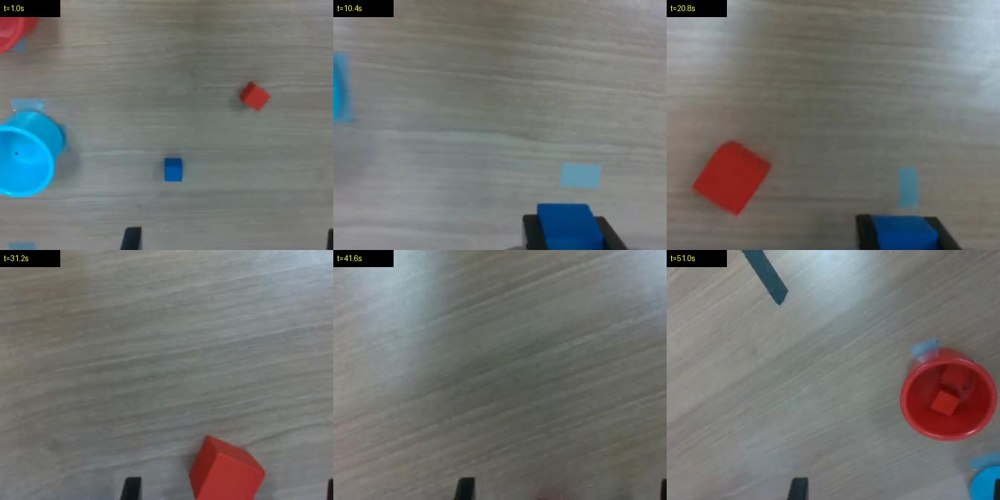

# Retake

**Every robot demo needs an alibi.**

Retake audits robot-learning datasets episode by episode and returns a trustworthy re-record list, with evidence for every flag. Robot companies pay for hours of demonstrations and then train on them blind; bad demos silently make the robot worse. Retake finds them before training does.

**▶ Live demo: https://thenandinee.github.io/retake/** · Built for the Nebius × NVIDIA Global AI Hackathon (Physical AI track)

---

## What it found in Hugging Face's community robot data

We scanned **all 1,754 sub-datasets of [`lerobot/community_dataset_v3`](https://huggingface.co/datasets/lerobot/community_dataset_v3)**: 72,356 episodes, **364.6 hours of robot data**, from 488 contributors. It ran overnight on a laptop with **$0 in model spend**.

- **7.1% of all episodes (5,125) are exact motion duplicates** (every joint, every frame) of episodes elsewhere in the collection. 777 duplicated recordings span *different contributors*, and 97 dataset pairs are at least 80% the same recordings. Example: `Dangvi/soarm100_data` ep0 and `s20000s/soarm100_data` ep0 are identical to 0.000000 across 426 frames.
- **763 episodes (1.05%) are objectively broken:**

| Issue | Episodes |
|---|---:|
| Empty fragment (under 1 s, some a single frame) | 338 |
| Robot never moves (every joint constant) | 219 |
| Duplicated inside the same dataset | 138 |
| Video and motion lengths disagree | 71 |
| Frozen joint sensor on a commanded arm | 56 |
| Timestamps run backwards | 15 |

Every one of these comes from a deterministic check, with no AI judgment, and every issue type was verified by hand. See [`EXPERIMENTS.md`](EXPERIMENTS.md) E018–E020 and [`evidence/HEADLINE.md`](evidence/HEADLINE.md).



## Proof: a frozen test set, run once

50 labeled episodes from the [BotFails](https://huggingface.co/datasets/kantine/BotFails) failure benchmark were set aside before any development. The pipeline was locked (git tag `v1.0-frozen`) and run on them **exactly once**.

| List | Precision | Real failures caught | Good demos flagged |
|---|---:|---:|---:|
| **Retake** (re-record these) | **100% (13/13)** | 13 / 25 | **0 / 25** |
| **Retake + review** | 82% (18/22) | **18 / 25** | 4 / 25 |

- 13/13 is a small sample: the 95% lower bound on retake precision is about 77%.
- **Integrity layer:** 100% detection on injected corruptions (30/30 per type), and 0 false alarms on 178 clean expert demos. The one flag it raised was a real 1.2-second motionless "expert" demo in the benchmark.
- **Cost: about $1.10 per 1,000 episodes.**

## How it works

```
LeRobot dataset (v2 or v3, read straight from Hugging Face, no video download)
  │
  ├─ 1. Integrity layer (code, free) ── 10 deterministic checks: empty, motionless, duplicate,
  │                                    frozen sensor, broken timestamps, video/motion mismatch,
  │                                    frozen or black video
  ├─ 2. Motion layer (statistics, free) ── per-task outliers: duration, hesitation, regrasps,
  │                                        jerk, tracking error
  ├─ 3. Vision layer (Nemotron 3.5 Super VL) ── 2 frames of a known-good reference demo
  │                                             + 6 frames of the episode → verdict + reason
  └─ 4. Report (Nemotron 3 Ultra + code guardrails)
        ├── retake list  ← code-check failures + vision flags with VISIBLE evidence only
        ├── review list  ← unconfirmed flags for a human look
        └── summary.md   ← Ultra writes prose; code computes every number and hotspot;
                           a validator removes unsupported claims
```

**Design decisions backed by experiments** ([`EXPERIMENTS.md`](EXPERIMENTS.md)):
- **Reference frames** from a known-good demo halved vision false alarms (E008).
- **Two tiers:** "incomplete" verdicts were right only 9/22 times, so they go to *review*, never *retake* (E011). Retake precision went from 40% to 80% on dev (E012).
- **Code decides facts, the LLM writes prose:** Ultra ignored counting rules in prompts, so hotspots are computed in Python and a validator checks the text (E013).
- **Measured and dropped:** gripper-event keyframes (E009), and two versions of Ultra-written task checklists (E021, E021b). Each made accuracy worse, so none ship. Adding text to the vision prompt hurt even when the text was accurate.
- **Leakage caught and fixed:** an early 65% result was invalidated after we found the benchmark's metadata had leaked into the prompt (E005 → E006).

## How Retake uses NVIDIA Nemotron and Nebius Token Factory

| Model (via Nebius Token Factory) | Role |
|---|---|
| `nvidia/Nemotron-3.5-Super-VL` | The vision layer: judges each episode against a reference demo. Thinking off, 8 images per request, JSON verdicts. |
| `nvidia/Nemotron-3-Ultra-550b-a55b` | Writes the audit summary under code-enforced guardrails. Also the planner behind the optional `--checklist` mode (tested; off by default, see E021). |

The cheapest tier is deterministic code: integrity and motion checks run on every episode for free, so the vision model only does work no code can do. Nemotron Nano and Lightning were evaluated as a middle tier and not needed.

**Tavily (runtime, inside every audit).** For each issue type found, Retake calls Tavily to search LeRobot's docs and GitHub issues. Nemotron 3 Ultra summarizes likely causes and fixes **using only those sources**, and code keeps a point only if (1) its verbatim quote is found in the cited source, (2) that source describes the same symptom, and (3) for LeRobot issues, the source is official LeRobot material. Anything else is removed, and "no verifiable guidance" is shown instead (E024–E024d). Example: for backwards timestamps, Retake points to LeRobot issue #2158; for video/motion length mismatches, to #3177 (`from_timestamp` drifting from the video's actual timing).

**Where Token Factory helped:**
- **OpenAI-compatible API:** one `base_url` change; no infrastructure to run.
- **Per-token prices from `/v1/models?verbose=true`** power Retake's built-in cost ledger and hard budget cap. Every call is cached, logged, and priced.
- **`enable_thinking=False`** on Super VL gave the same answers with ~9× fewer output tokens and 2.5× lower latency (E000).
- **Multi-image prompts (up to 8)** made the reference-plus-episode design possible in a single call.
- **Total model spend across all 23 experiments: $0.46.**

## Quick start

Requires Python 3.11+, [`uv`](https://docs.astral.sh/uv/), and `ffmpeg`.

```bash
git clone https://github.com/TheNandinee/retake && cd retake
uv sync
cp .env.example .env          # add your Nebius Token Factory API key
```

Audit 10 episodes of a community dataset, reading video remotely (about 1¢):

```bash
uv run python -m retake.audit lerobot/community_dataset_v3 \
  --subset 00ri/so100_battery --limit 10 --remote --out reports/my_first_audit
open reports/my_first_audit/summary.md
```

Integrity-only scan with no model calls (free):

```bash
uv run python -m retake.audit lerobot/community_dataset_v3 --subset 00ri/so100_battery --vision none
```

Output: `report.json`, `episodes.csv`, `summary.md`, `retake_list.txt`, `review_list.txt`, `clean_episodes.txt`, and a frame sheet for every flagged episode.

Useful flags: `--remote` (no video download), `--limit N`, `--workers N`, `--vision all|flagged|none`, `--save-all-frames`. Set `RETAKE_DRY_RUN=1` to see which model calls a run would make without spending anything.

## Reproduce the results

```bash
# Frozen test set (E022)
uv run python -m retake.audit kantine/BotFails --only evidence/splits/botfails_TEST_frozen.csv --remote --workers 8 --out reports/botfails_TEST
uv run python -m scripts.06_eval_audit reports/botfails_TEST/episodes.csv

# Integrity corruption benchmark (E016–E020)
uv run python -m scripts.10_integrity_bench

# Full community scan (E018–E020): overnight on a laptop, resumable
uv run python -m scripts.12_discover_roots
uv run python -m scripts.13_integrity_scan
uv run python -m scripts.14_scan_report results/scan/integrity_scan.jsonl
```

## Limitations

- The retake list favors certainty over coverage: on the test set it caught about half of all real failures; the review list brings that to 72%.
- Failures that happen mid-task and leave no visible trace at the end (wrong hole probed, a button pressed out of order) remain hard for the vision layer.
- The labeled benchmark (BotFails) is small, and the test set is 50 episodes. Community vision findings are verified examples, not a measured rate.
- Supports the LeRobot dataset format (v2 and v3).

## Repository map

```
retake/           audit pipeline: audit.py, integrity.py, signals.py, vision.py, llm.py, checklist.py
scripts/          experiments, benchmarks, community scan, site builder
evidence/         experiment logs, frozen splits, snapshots, verified headline
reports/          generated audit reports
docs/             the demo site (GitHub Pages)
EXPERIMENTS.md    every experiment, including the ones that failed
```

## License

Apache-2.0